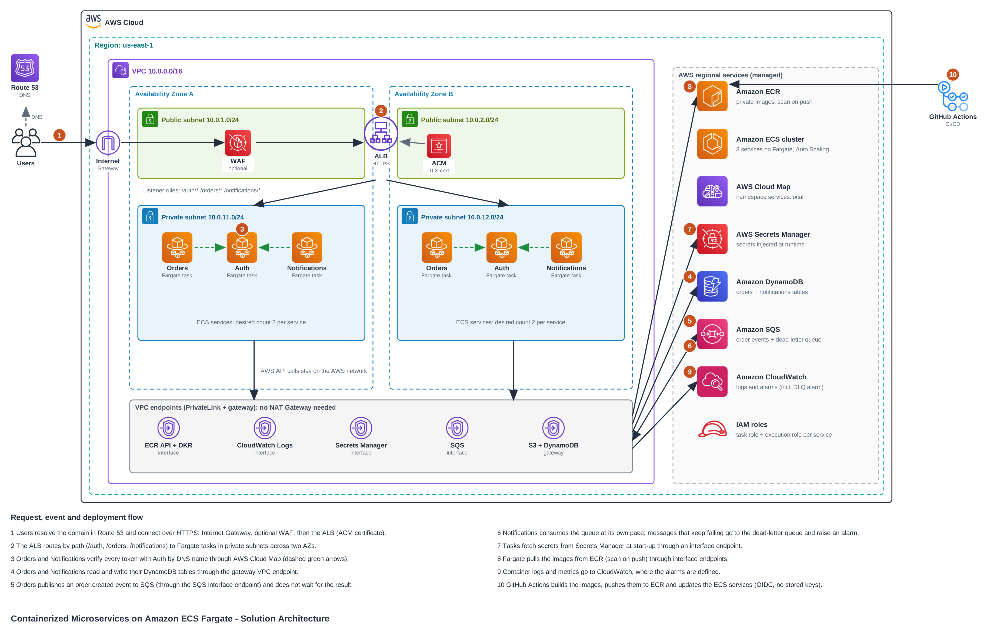

# Containerized Microservices on Amazon ECS Fargate

A highly available, secure and loosely coupled microservices platform on AWS, built with Amazon ECS Fargate and designed against the AWS Well-Architected Framework. The repository contains the architecture and the reasoning behind it, a small working implementation of three services, the Terraform that builds the whole environment, and the GitHub Actions pipelines that test and deploy it.

- [1. Overview](#1-overview)
- [2. Architecture diagram](#2-architecture-diagram)
- [3. Requirements and assumptions](#3-requirements-and-assumptions)
- [4. How it works](#4-how-it-works)
- [5. Design decisions: what, why, and what else I considered](#5-design-decisions-what-why-and-what-else-i-considered)
- [6. Network and security design](#6-network-and-security-design)
- [7. What happens when something fails](#7-what-happens-when-something-fails)
- [8. Well-Architected Framework alignment](#8-well-architected-framework-alignment)
- [9. Cost](#9-cost)
- [10. Limitations and next steps](#10-limitations-and-next-steps)
- [11. Repository structure](#11-repository-structure)
- [12. Run it locally](#12-run-it-locally)
- [13. Deploy to AWS](#13-deploy-to-aws)
- [14. CI/CD](#14-cicd)

## 1. Overview

**The problem.** A monolithic Node.js application is hard to run as one unit: a bug in one feature can take everything down, the whole thing has to be scaled and released together, and every component shares the same permissions and secrets.

**The solution.** Split it into three independently deployable services and run them as containers on ECS Fargate, so there are no servers to patch:

| Service | Responsibility | State |
|---|---|---|
| **Auth** | Issues and verifies JWTs (`POST /auth/login`, `GET /auth/verify`) | None. The signing key comes from Secrets Manager. |
| **Orders** | Creates and reads a user's orders; every call is authenticated through Auth; publishes an `order.created` event | DynamoDB `orders` table |
| **Notifications** | Consumes `order.created` events from a queue and stores a notification for the user; `GET /notifications` returns the caller's notifications | DynamoDB `notifications` table |

The key architectural idea is that the services talk to each other in **two different ways, chosen on purpose**:

- **Synchronous (HTTP, discovered by DNS)** when the caller needs the answer right now: Orders and Notifications ask Auth "who is this token?".
- **Asynchronous (events through SQS)** when the caller does not need to wait: Orders announces "an order was created" and moves on. Notifications reacts in its own time. If Notifications is slow or down, ordering keeps working.

**What is real and what is demo-grade.** The infrastructure, the networking, the IAM model, the deployment pipeline and the messaging pattern are built the way I would build a first production version. The application logic is intentionally small: Auth uses a fixed list of demo users and "sending" a notification means storing it and logging it. Section 10 lists what a real system would add.

## 2. Architecture diagram



The editable source is [`docs/architecture.drawio`](docs/architecture.drawio) (open it at [app.diagrams.net](https://app.diagrams.net)); an SVG is next to it. The numbered badges match the numbered steps in section 4.

In one paragraph: users reach an **Application Load Balancer** in public subnets (DNS from Route 53, TLS certificate from ACM, optional WAF). The ALB forwards by URL path to **Fargate tasks in private subnets** spread over **two Availability Zones**. The tasks have no route to the internet: they reach AWS services (ECR, CloudWatch Logs, Secrets Manager, SQS, S3, DynamoDB) through **VPC endpoints**. Services find each other through **AWS Cloud Map** private DNS. Orders and Notifications are decoupled by an **SQS queue with a dead-letter queue**. Everything is created by **Terraform** and released by **GitHub Actions**.

## 3. Requirements and assumptions

I wrote the requirements first and let them drive the design.

| Requirement | What it led to |
|---|---|
| Survive the loss of one Availability Zone and of individual containers | Two AZs, one task per service per AZ, ALB health checks, ECS self-healing, deployment circuit breaker |
| The internet can reach the ALB and nothing else | Tasks in private subnets with no public IP and no internet route; security groups that only allow the exact paths in section 6 |
| One compromised or buggy service must not be able to touch everything | One IAM task role per service with only the actions it needs; secrets only injected into the service that needs them |
| A slow or failing downstream service must not break the customer's request | Asynchronous events through SQS between Orders and Notifications; retry plus dead-letter queue |
| Releases must be repeatable and reversible | Infrastructure as code, immutable image tags (commit SHA), rolling deployments with automatic rollback |
| Cost must follow usage and be explainable | Fargate task sizes, on-demand DynamoDB, a per-service Auto Scaling range, and a written cost model (section 9) |

Assumptions: modest and variable traffic, a single AWS region, stateless services (all state lives in DynamoDB and SQS), and a small team that does not want to operate servers or a Kubernetes cluster.

## 4. How it works

### Request flow (synchronous)

1. **Entry.** A user resolves the domain in **Route 53** and connects over HTTPS. Traffic enters through the **Internet Gateway**, passes the optional **WAF**, and reaches the **Application Load Balancer** in the public subnets, which terminates TLS with a certificate from **ACM**.
2. **Routing.** The ALB's listener rules send `/auth/*`, `/orders/*` and `/notifications/*` to the matching target group. Targets are the Fargate tasks' IP addresses in the private subnets of both AZs, and only healthy targets (answering `GET /health`) receive traffic.
3. **Service discovery.** Orders and Notifications call Auth at `http://auth.services.local:3000`. That name is registered by ECS in **AWS Cloud Map** and always resolves to the IPs of the currently running Auth tasks.
4. **Data.** Orders reads and writes its **DynamoDB** table and Notifications reads and writes its own, through a **gateway VPC endpoint**, so the traffic never leaves the AWS network.

### Event flow (asynchronous)

5. **Publish.** After saving an order, Orders sends an `order.created` message to the **SQS** queue (through the SQS interface endpoint) and returns `201` to the user without waiting for anything else.
6. **Consume.** Notifications polls the queue with long polling, turns each event into a stored notification, and deletes the message only after the notification was saved. A message that fails repeatedly is moved to the **dead-letter queue** and raises a CloudWatch alarm.

### Platform flow

7. **Secrets.** At start-up ECS reads the JWT signing key from **Secrets Manager** and injects it as an environment variable into the Auth container only.
8. **Images.** Fargate pulls the container images from **ECR** (scanned on push) through interface endpoints.
9. **Observability.** Containers write JSON logs to **CloudWatch Logs**; CloudWatch alarms watch error rates, unhealthy targets, CPU, queue age and the dead-letter queue.
10. **Delivery.** **GitHub Actions** builds each image, scans it, pushes it to ECR with the commit SHA as tag, and updates the ECS service. It authenticates to AWS with short-lived OIDC credentials, so no access keys are stored in GitHub.

## 5. Design decisions: what, why, and what else I considered

| Decision | Why | Alternative I considered, and why not |
|---|---|---|
| **ECS on Fargate** for compute | No instances to patch or scale, per-task IAM roles and networking, pay for the CPU and memory tasks actually use. | *EKS*: far more capability than three services need, and it adds a control-plane fee and cluster upgrades to operate. *ECS on EC2*: cheaper at steady high load, but I would own the OS and the capacity planning. *Lambda + API Gateway*: very cost-effective for spiky, low traffic, but the goal here is container-based microservices with their own runtime and networking. |
| **Two AZs, one task per service per AZ** | Survives an AZ failure with no manual action and uses the capacity in normal operation. | *Three AZs*: more resilience at 50% more baseline cost; two is the usual balance for this size. *One AZ*: cheapest, but a single point of failure. |
| **Private subnets + VPC endpoints, no NAT Gateway** | The tasks never need the internet, so they get no route to it. That removes a whole class of risk (data exfiltration, unwanted outbound calls). Endpoints also keep AWS API traffic on the AWS network. | *NAT Gateway*: simpler and cheaper for a very small environment (a single NAT costs less than five interface endpoints in two AZs) but it gives the tasks general internet access. I chose the stricter design and say so in the cost section. |
| **Application Load Balancer with path-based rules** | One public entry point, layer-7 routing, per-service health checks, TLS termination, integration with WAF and ECS. | *API Gateway*: useful for per-client throttling, API keys and request validation, which this project does not need. *One ALB per service*: more cost and more public surface. |
| **AWS Cloud Map for service-to-service calls** | ECS registers and deregisters task IPs automatically; callers use a stable DNS name; no extra load balancer or proxy to pay for. | *Internal ALB*: adds a hop, a cost and a component per service. *ECS Service Connect*: AWS's newer, richer option (retries, per-connection metrics). I would move to it if I needed those features; plain DNS keeps this version easy to read and debug. |
| **SQS between Orders and Notifications** | Decoupling in time: Orders does not wait for, or depend on, Notifications. The queue absorbs bursts, retries failures, and keeps messages for 4 days if the consumer is down. | *Calling Notifications over HTTP*: simpler, but a Notifications outage would break order creation. *SNS + SQS fan-out*: the right next step when a second consumer appears (email, analytics, inventory); with one consumer, one queue is enough. *EventBridge*: powerful routing and schema registry, more than one event type needs. |
| **Dead-letter queue + alarm** | A message that cannot be processed must not be lost or retried forever. After 5 failed attempts it is parked for 14 days and an alarm tells the operator. | *No DLQ*: poison messages would block or loop silently. |
| **Idempotent event handling** | SQS standard queues deliver *at least once*. The notification id is derived from the order id, so a duplicate delivery overwrites the same item instead of creating a second notification. | *FIFO queue with deduplication*: stricter ordering and dedupe, lower throughput and higher price; idempotent code is needed anyway. |
| **DynamoDB (on-demand)** for data | Access is always "by user": a key-value pattern with no joins. Multi-AZ by default, no servers, no capacity planning, point-in-time recovery on. | *RDS/Aurora*: the better choice if the system needs ad-hoc queries, joins or reporting across users. |
| **Secrets Manager** injected by ECS | The JWT signing key never appears in the image, the repository or the task definition; only the execution role can read it, and only Auth receives it. | *SSM Parameter Store*: cheaper for plain configuration; Secrets Manager adds rotation support. *Environment variables in Terraform*: would put the secret in plain text in the task definition. |
| **Own Auth service issuing JWTs** | Shows service-to-service authentication, discovery and failure handling in the demo. | *Amazon Cognito*: the managed answer, and what I would use for real users (sign-up, MFA, password reset, federation). *Verifying the JWT locally in every service*: faster and removes the runtime dependency on Auth, but then revocation and key rotation are harder. Calling Auth costs a little latency in exchange for one place that decides. |
| **Terraform** | Repeatable, reviewable and destroyable infrastructure; the `services` map in `locals.tf` generates the per-service resources, so adding a fourth service is one entry. | *CloudFormation/CDK*: equally valid; Terraform was chosen for readability and portability. |
| **GitHub Actions with OIDC** | The code is in GitHub, nothing extra to pay for or operate, and no long-lived AWS keys exist to leak. The deploy role can only be assumed by workflows on the `main` branch of this repository. | *CodePipeline/CodeDeploy*: AWS-native and supports blue/green, at the price of more services to configure. |
| **Rolling deployments with a circuit breaker** | New tasks must pass health checks before old ones stop; if the new version keeps failing, ECS rolls back by itself. | *Blue/green with CodeDeploy*: safer traffic shifting and instant rollback, more moving parts. |
| **ALB (and optional WAF) instead of CloudFront** | The API is dynamic and not cacheable, so CloudFront would add cost and complexity without a benefit here. AWS Shield Standard already protects the ALB from common network-layer attacks at no cost. | *CloudFront*: add it if static content, global latency or origin shielding becomes a requirement. |

## 6. Network and security design

### Network

| Layer | Subnets | What lives there |
|---|---|---|
| Public (`10.0.1.0/24`, `10.0.2.0/24`) | Route to the Internet Gateway | Only the Application Load Balancer |
| Private (`10.0.11.0/24`, `10.0.12.0/24`) | **No default route** | Fargate tasks and the interface VPC endpoints |

The private route table has no route to the internet. AWS services are reached through five interface endpoints (ECR API, ECR DKR, CloudWatch Logs, Secrets Manager, SQS) and two gateway endpoints (S3, which ECR needs for image layers, and DynamoDB).

### Who may talk to whom (security groups)

| From | To | Port | Why |
|---|---|---|---|
| Internet | ALB | 80, 443 | Public entry point (80 only redirects to HTTPS when a certificate is configured) |
| ALB | Tasks | 3000 | Forward requests |
| Tasks | Tasks | 3000 | Orders and Notifications call Auth |
| Tasks | Interface endpoints | 443 | ECR, Logs, Secrets Manager, SQS |
| Tasks | S3 and DynamoDB (managed prefix lists) | 443 | Image layers, data |

There is no other rule. In particular, nothing allows a task to reach the internet, and nothing allows the internet to reach a task.

### Identity and secrets (IAM)

| Role | Can do |
|---|---|
| ECS execution role (shared) | Pull images, write logs, read the one JWT secret. Used by the ECS agent, not by application code. |
| Task role: **auth** | Nothing in AWS (it only needs its injected secret) |
| Task role: **orders** | `dynamodb:PutItem/GetItem/Query` on the orders table; `sqs:SendMessage` on the queue |
| Task role: **notifications** | `sqs:ReceiveMessage/DeleteMessage/ChangeMessageVisibility/GetQueueAttributes` on the queue; `dynamodb:PutItem/Query` on the notifications table |
| GitHub deploy role | Push to the three ECR repositories, register task definitions, update the three services, pass the ECS roles. Assumable only from the `main` branch of this repository. |

### Other controls

- **Encryption in transit:** HTTPS at the ALB (ACM certificate, TLS 1.3 policy, HTTP redirects to HTTPS); AWS API calls use TLS.
- **Encryption at rest:** DynamoDB and Secrets Manager with AWS-managed KMS keys, SQS server-side encryption, ECR AES-256.
- **Containers:** run as a non-root user with a read-only root filesystem; image tags are immutable; images are scanned on push (ECR) and in CI (Trivy).
- **Optional WAF** (`enable_waf = true`): AWS managed common rule set plus a per-IP rate limit, which also slows down password guessing on `/auth/login`.
- **Everything is auditable:** all infrastructure is code, and CloudWatch keeps the logs for 14 days.

## 7. What happens when something fails

| Failure | What happens | Why that is acceptable |
|---|---|---|
| A container crashes or stops answering | The ALB stops sending it traffic after 3 failed health checks (15 s apart) and ECS starts a replacement. The other task keeps serving. | Two tasks per service |
| An entire Availability Zone is lost | The ALB sends all traffic to the tasks in the other AZ; ECS launches replacements there; Auto Scaling adds capacity if CPU or request rate rises. | Each service has a task in each AZ |
| Auth is down | Orders and Notifications return `503` for authenticated calls (they fail closed). Events already in the queue still get processed, because the consumer does not call Auth. | Secure default; the dependency is visible |
| Notifications is down or slow | Orders is unaffected. Events wait in the queue (kept for 4 days). The "oldest message older than 5 minutes" alarm fires. When Notifications recovers it drains the backlog. | This is the reason for the queue |
| A message cannot be processed (a bug or bad data) | It is retried (the visibility timeout is 60 s); after 5 attempts SQS moves it to the dead-letter queue and the DLQ alarm fires. Messages stay there 14 days for inspection and redrive. | No silent loss, no infinite loop |
| A message is delivered twice | The notification id is derived from the order id, so the second write overwrites the first. | At-least-once delivery is handled |
| A bad release is deployed | New tasks fail their health checks, the deployment circuit breaker trips and ECS rolls back to the previous task definition. | Failed releases do not take the service down |
| Traffic spikes | Target-tracking Auto Scaling adds tasks (CPU at 60% or 500 requests per target per minute); DynamoDB on-demand and SQS scale on their own. | Capacity follows load |
| The SQS publish fails after the order was saved | The order is kept and the error is logged; the notification for it is lost. See section 10. | Known trade-off, with the fix described |
| The whole region is unavailable | Not covered. The environment can be recreated in another region with Terraform, but data is not replicated. | Out of scope for the stated requirements |

## 8. Well-Architected Framework alignment

### Operational Excellence
- All infrastructure is Terraform (`infra/`); the per-service resources are generated from one map.
- GitHub Actions runs tests, image builds and scans, and Terraform checks on every pull request, and deploys on every merge to `main`.
- Structured JSON logs go to one CloudWatch log group per service; alarms notify an SNS topic.
- Services shut down cleanly on `SIGTERM`, so deployments and scale-in do not drop in-flight requests.

### Security
- Only the ALB is public; tasks have no public IP and no route to the internet (section 6).
- Least-privilege IAM per service; secrets in Secrets Manager; non-root, read-only containers; immutable, scanned images.
- OIDC instead of stored credentials for the pipeline; optional WAF; encryption in transit and at rest.

### Reliability
- Two Availability Zones, health checks at the load balancer and in the container, self-healing ECS services.
- Automatic rollback on failed deployments; Auto Scaling on CPU and request count.
- Asynchronous decoupling with retries and a dead-letter queue; idempotent consumers.
- DynamoDB is multi-AZ with point-in-time recovery.

### Performance Efficiency
- Right-sized tasks (0.25 vCPU / 0.5 GB to start, set by variables) and target-tracking scaling.
- On-demand DynamoDB and SQS follow the load without capacity planning.
- Long polling reduces empty receives and latency; gateway endpoints keep S3 and DynamoDB traffic on the AWS network.

### Cost Optimization
- Pay-per-use compute and data stores, a small ECR image history, 14-day log retention.
- The most expensive choices (interface endpoints, two tasks per service) are visible in section 9, with the levers to reduce them.

### Sustainability
- Serverless compute and on-demand scaling avoid idle capacity; scale-in releases resources when traffic drops.
- A single region and right-sized tasks keep the footprint small.

## 9. Cost

Approximate **on-demand list prices in us-east-1**, running **24/7** with the defaults (2 tasks per service, 6 tasks). Treat them as an order of magnitude and check the [AWS Pricing Calculator](https://calculator.aws/) for current numbers.

| Item | Approx. per month |
|---|---|
| Fargate: 6 tasks of 0.25 vCPU / 0.5 GB | about $185 |
| Interface VPC endpoints: 5 endpoints x 2 AZs | about $73 |
| Application Load Balancer | about $22 |
| CloudWatch alarms, logs, SQS, DynamoDB on-demand, Secrets Manager, Route 53 zone | a few dollars at low traffic |
| AWS WAF, if enabled | about $8 |

How to bring it down: `desired_count = 1` halves the Fargate line; a **NAT Gateway instead of the endpoints** (one NAT costs about $33 plus data) is cheaper for a small environment, at the price of giving tasks internet access; and the whole stack can be destroyed when it is not needed (`terraform destroy`). This design deliberately favours isolation over the lowest bill.

## 10. Limitations and next steps

Being explicit about what this version does not do:

- **Dual write between DynamoDB and SQS.** Orders saves the order and then publishes the event; if the publish fails, the order exists but no notification is created. The robust fix is the *transactional outbox* pattern, or DynamoDB Streams feeding EventBridge Pipes into SQS, so the event is produced from the committed write.
- **Demo identity.** Auth has a fixed list of demo users. A real system would use Amazon Cognito or a user table with hashed passwords, and rotate the signing key automatically.
- **Notification delivery is simulated.** The handler stores and logs the notification. A real one would call SNS or SES from the same place.
- **Single region.** Add DynamoDB global tables and a second environment for disaster recovery if the requirement appears.
- **More observability.** Distributed tracing (X-Ray / OpenTelemetry), Container Insights, ALB access logs and VPC flow logs.
- **Safer releases.** Blue/green deployments with CodeDeploy and a smoke-test stage.
- **WAF on by default** for any internet-facing production use.

## 11. Repository structure

```
.
├── README.md
├── docker-compose.yml          # run everything locally (with ElasticMQ standing in for SQS)
├── local/elasticmq.conf        # local queue + dead-letter queue definition
├── docs/
│   ├── architecture.png        # the diagram above
│   ├── architecture.svg
│   └── architecture.drawio     # editable source
├── services/
│   ├── auth/                   # Node.js 22, no runtime dependencies
│   ├── orders/                 # Node.js 22, AWS SDK v3 (DynamoDB, SQS)
│   └── notifications/          # Node.js 22, AWS SDK v3 (SQS, DynamoDB)
│       (each has src/, test/, Dockerfile, package.json)
├── infra/                      # Terraform (see infra/README.md)
├── scripts/
│   └── bootstrap-images.sh     # one-time first image push
└── .github/
    ├── workflows/ci.yml        # tests, docker build + scan, terraform validate
    ├── workflows/deploy.yml    # build, scan, push to ECR, roll ECS services
    └── dependabot.yml
```

## 12. Run it locally

Requirements: Docker (or Node.js 20+ for the unit tests).

```bash
docker compose up --build

# log in as a demo user
TOKEN=$(curl -s -X POST localhost:3001/auth/login \
  -H 'content-type: application/json' \
  -d '{"username":"alice","password":"alice-demo-pw"}' | jq -r .token)

# create an order: Orders verifies the token with Auth, saves the order, publishes an event
curl -s -X POST localhost:3002/orders -H "authorization: Bearer $TOKEN" \
  -H 'content-type: application/json' -d '{"items":[{"sku":"BOOK-1","qty":2}]}'

# a few seconds later Notifications has consumed the event
curl -s localhost:3003/notifications -H "authorization: Bearer $TOKEN"
```

Ports: 3001 Auth, 3002 Orders, 3003 Notifications, 9324 the local queue. Locally both services use in-memory stores; in AWS they use DynamoDB.

Unit tests:

```bash
cd services/auth && npm test
cd services/orders && npm ci && npm test
cd services/notifications && npm ci && npm test
```

### API summary

| Method and path | Service | Auth | Purpose |
|---|---|---|---|
| `POST /auth/login` | Auth | none | `{username, password}` returns `{token, expiresIn}` |
| `GET /auth/verify` | Auth | Bearer | Returns the user the token belongs to |
| `POST /orders` | Orders | Bearer | `{items:[{sku, qty}]}` creates an order and publishes `order.created` |
| `GET /orders`, `GET /orders/{id}` | Orders | Bearer | The caller's orders |
| `GET /notifications` | Notifications | Bearer | The caller's notifications, newest first |
| `GET /health` | each task | none | Used by the ALB and ECS health checks (not routed by the ALB) |

## 13. Deploy to AWS

Details, variables and cost notes are in [`infra/README.md`](infra/README.md).

1. Create the ECR repositories: `terraform -chdir=infra apply -target=aws_ecr_repository.svc`
2. Push the first images: `./scripts/bootstrap-images.sh`
3. Create everything else: `terraform -chdir=infra apply`
4. Test through the ALB with the calls from section 12, replacing `localhost:300x` by `terraform -chdir=infra output -raw app_url`. The ALB routes by path, so login is `POST <app_url>/auth/login` and orders are under `<app_url>/orders`.
5. Remove everything when done: `terraform -chdir=infra destroy`

Optional variables: `domain_name` + `route53_zone_id` (custom domain with an ACM certificate and HTTPS), `enable_waf`, `alarm_email`, `github_repo` (creates the deploy role for GitHub Actions), `desired_count`.

## 14. CI/CD

- **`ci.yml`** (every pull request and push): unit tests for each service, Docker build plus a Trivy vulnerability scan for each image, `terraform fmt`, `validate` and a Trivy misconfiguration scan of `infra/`.
- **`deploy.yml`** (push to `main` that changes `services/`): assume the AWS deploy role through OIDC, build and scan each image, push it to ECR tagged with the commit SHA, render a new task definition revision and update the ECS service, waiting until it is stable. The job is skipped until the repository variable `AWS_ROLE_ARN` is set, so the repository stays green when it is documented but not deployed.
- **Terraform and CI/CD each own one thing.** Terraform creates the first task definition and then ignores later changes to the service's task definition and desired count, so a later `terraform apply` never rolls back a release or fights Auto Scaling.
- **Dependabot** keeps the GitHub Actions, npm packages, Docker base images and Terraform providers up to date.

## Author

Ayoub Zakarya
